# SPABS-V2


Sports academy player & business management system — tracks players, teams, coaches, parents,
training/matches, attendance, skill progress, fees, inventory, sponsorships, and finances for a
youth sports academy. Two-part project: a Spring Boot REST API and a React SPA that consumes it.

## Re-engineered from SPABS

SPABS-V2 is a ground-up re-engineering of [SPABS](https://github.com/ahmadisyraf39/spabs), an
earlier academic/legacy build of the same academy-management idea. Re-engineered a monolithic
system into a decoupled architecture: a stateless Spring Boot REST API with role-based JWT
authentication via Spring Security, and a React (Vite) frontend with a fetch-based API client.

Redesigned the relational schema with Spring Data JPA/Hibernate to support multi-team history for
players and coaches (replacing SPABS's single-team model, where each player/coach row carried one
static `kategori` column with no history). Leaving a team now marks the membership `INACTIVE`
with a leave date, so the history is kept (SPABS issued a plain SQL `DELETE` on removal); a
separate, clearly warned permanent remove still exists for entries added by mistake. Data access
throughout uses Spring Data JPA repository interfaces with derived query methods rather than
hand-written SQL.

### What's new

- A `SUPER_ADMIN` role on top of Admin/Coach/Parent
- `Team` as a first-class entity, with `PlayerTeam`/`CoachTeam` join entities tracking full
  roster and coaching-staff history (jersey numbers, roles, join/leave dates, status) instead of
  a single category field per player/coach
- Inventory management (equipment catalog + stock transactions)
- Sponsorships (sponsor catalog + club sponsorship records)
- A general finance transaction ledger, alongside fee records and coach payroll
- Recurring-activity scheduling (generate a whole term's training sessions from one weekly rule)
- Richer role dashboards with charts (attendance/progress trends, finance trend, fee collection)
- Dedicated self-service portals for Coach and Parent roles, not just a shared dashboard
- Forced password change on first login and self-service, email-based password reset

### What's dropped

A few SPABS features weren't carried over:

- Photo/video gallery and albums
- Online fee payment via Stripe checkout (SPABS-V2's "mark as paid" is admin-triggered, not a
  parent-facing payment gateway)
- Generated invoices
- Parent-submitted absence/leave requests
- Dedicated player-selection-for-activity screens (squad selection)
- Tournament as its own managed entity — SPABS-V2 only has `TOURNAMENT` as one `Activity` type,
  not a separate module

## Architecture

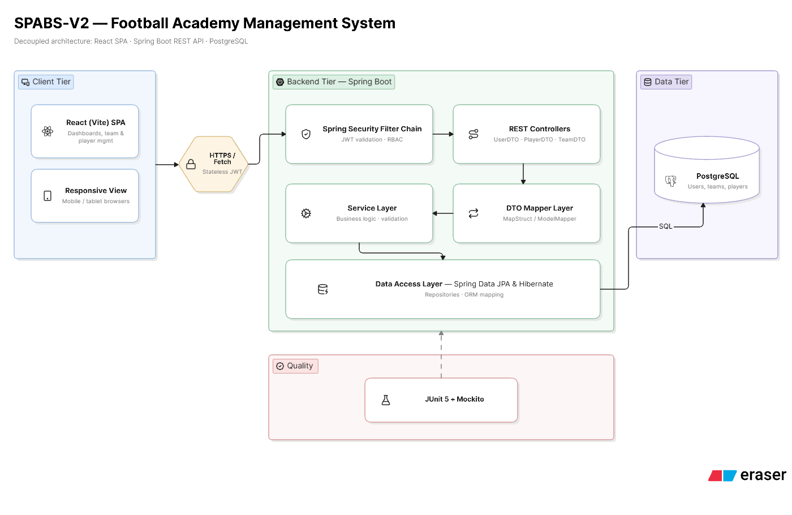

## Stack

**Backend** (`spabs-v2-backend/`)
- Java 25, Spring Boot 4.1.1
- Spring Data JPA + PostgreSQL, derived-method repository queries (no hand-written JPQL/SQL)
- Spring Security with JWT auth (`jjwt`)
- MapStruct for entity/DTO mapping, Lombok
- Spring Mail (welcome emails, password reset)

**Frontend** (`spabs-v2-frontend/`)
- React 19 + Vite 8, plain JavaScript (no TypeScript)
- Tailwind CSS v4 + DaisyUI v5
- React Router v7
- A thin `fetch`-based API client (no Axios)
- Recharts (dashboard charts)

## Features

- Role-based access: `SUPER_ADMIN`, `ADMIN`, `COACH`, `PARENT`, each with their own dashboard and
  (for Coach/Parent) a self-service portal scoped to their own teams/children
- Player, team, and roster management (player↔team and coach↔team assignments with jersey
  numbers/roles/status history)
- Activities (training/matches/tournaments), including recurring-schedule generation, with
  per-session attendance tracking
- Skill/module curriculum and per-player progress tracking, scoped by age group + category
- Fee catalog, fee assignment/payment tracking, and coach payroll
- Inventory catalog with stock transactions (purchases, adjustments, damage/loss)
- Sponsorships and a general finance transaction ledger, with admin dashboard charts (income vs.
  expense trend, fee collection, attendance/progress by team)
- Team/academy-wide announcements
- JWT authentication with forced password change on first login, self-service password reset via
  email, and a "My Profile" page for every role

## Screenshots

| | |
| --- | --- |
| 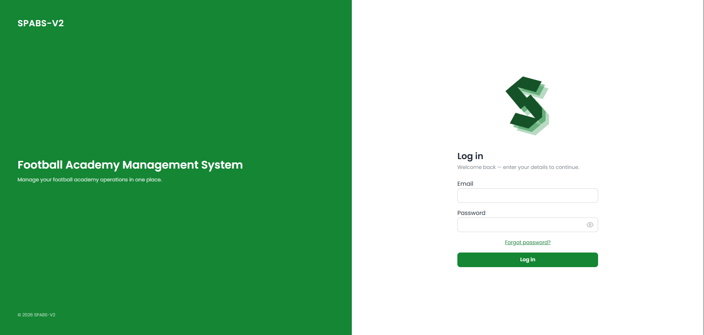 Login | 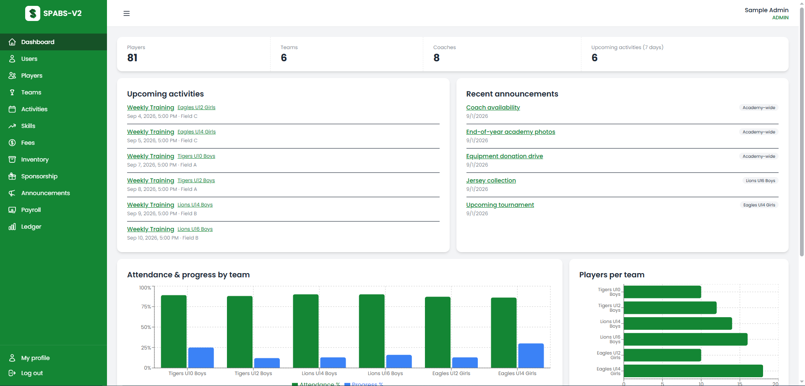 Admin dashboard |
| 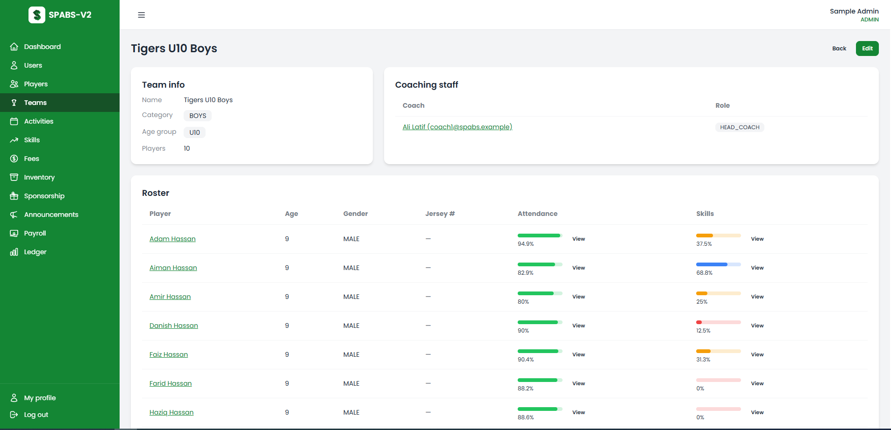 Team details | 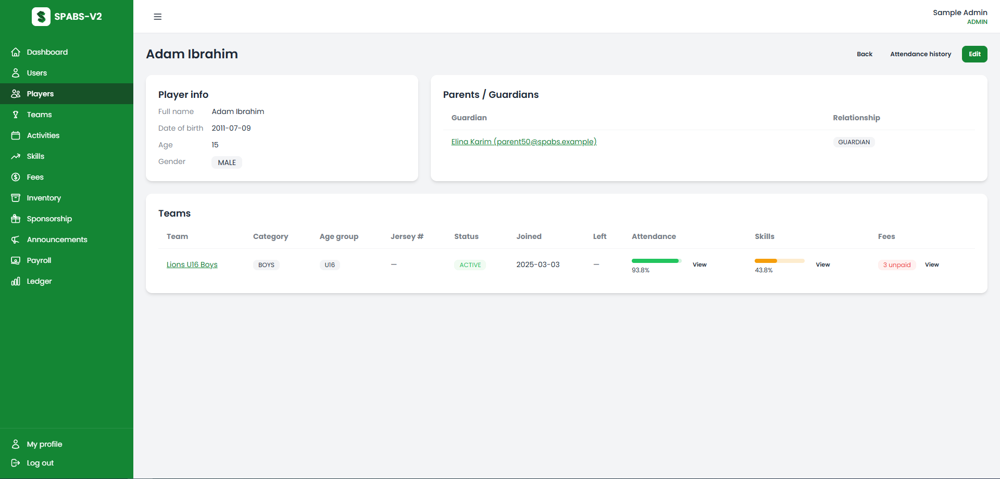 Player details |
| 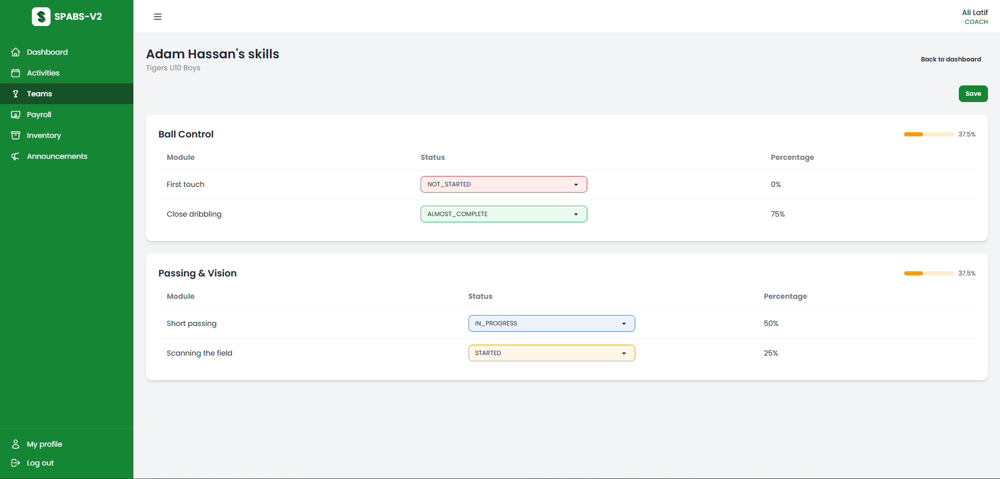 Player skill progress | 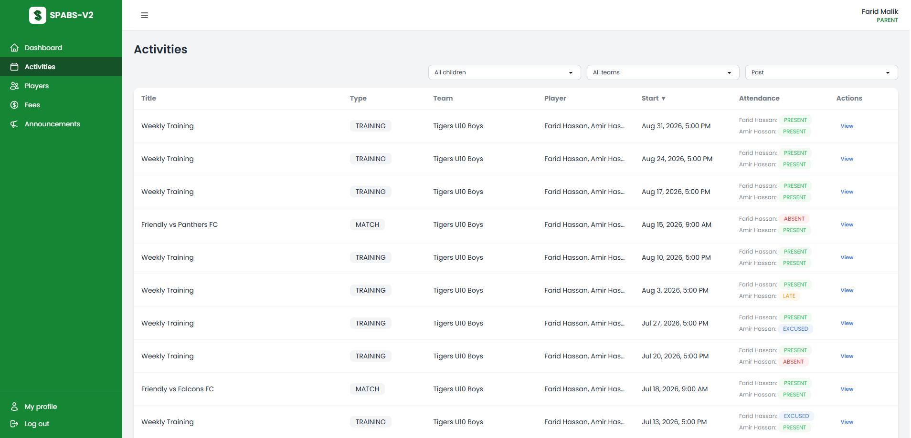 Player activity/attendance history |
| 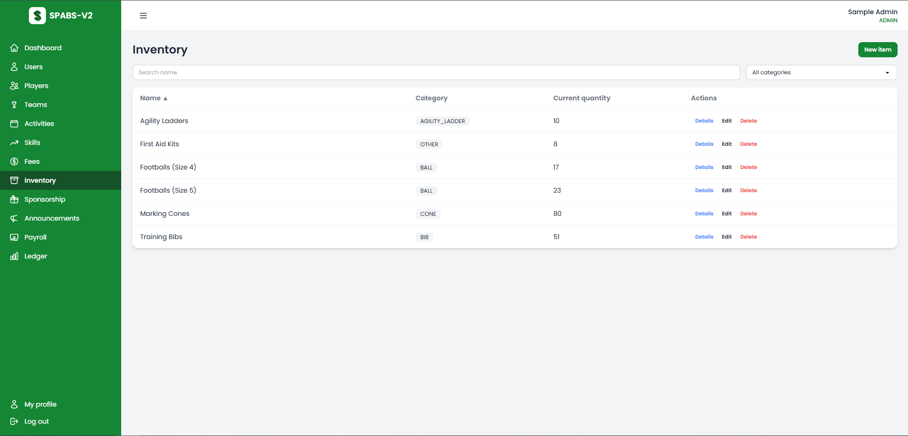 Inventory | 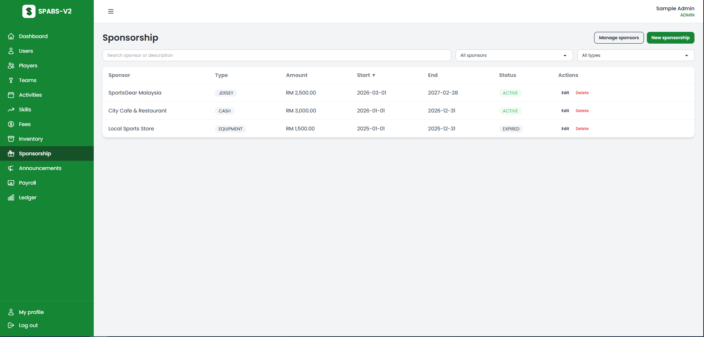 Sponsorship |
| 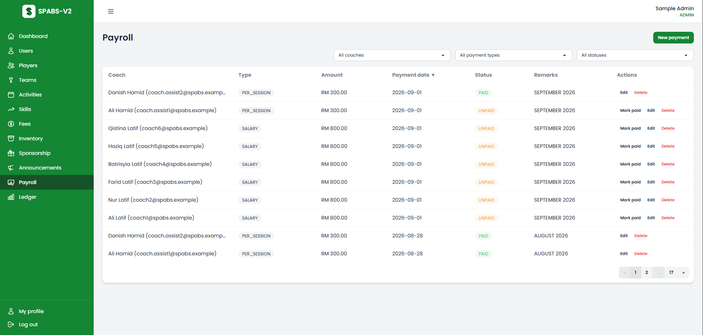 Coach payroll | 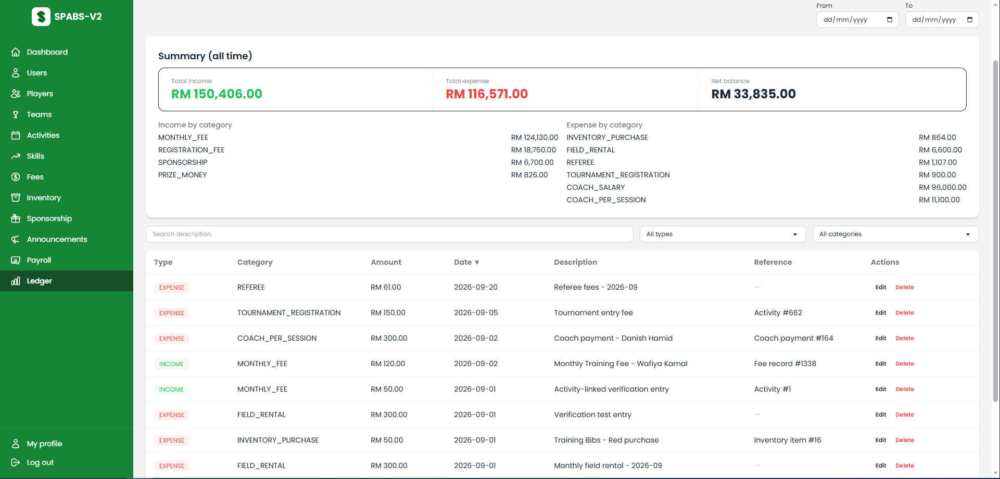 Finance ledger |

## Automated testing & CI

The `spabs-v2-autotests/` module holds an automated test suite for the running app:

- **API tests** with REST Assured: authentication, role-based access, data scoping, CRUD and
  validation, fees and payments, recurring scheduling, attendance rules, membership history
- **UI tests** with Selenium WebDriver: Page Object Model, `data-testid` locators, explicit waits
  only, test data created through the API before each UI test
- **TestNG** for structure: data providers, groups (known bugs are tagged and excluded from the
  build until fixed), soft assertions

**CI:** every pull request and every push to `main` runs the whole suite in GitHub Actions. The
workflow starts the full stack with Docker Compose, runs the API tests and the UI tests in headless
Chrome, and uploads the test reports, failure screenshots and container logs. `main` is protected:
every change goes through a pull request, and the test check must pass before it can be merged.

**Bugs found by the tests** (filed as GitHub Issues):

| Issue | Finding |
|---|---|
| #8 | `GET /users` and `GET /parents` return every user's contact details to any logged-in user |
| #9 | A parent can read another child's profile and attendance |
| #10 | A coach can read the roster of a team they don't coach (needs a product decision) |
| #12 | "Today" used the UTC date, so dates were a day behind between 00:00 and 08:00 MYT (fixed) |

Setting up CI also surfaced environment bugs: a container running on UTC rejected valid attendance
records, and date inputs typed in one browser locale were read differently in another. Both are
fixed and explained in the [test README](spabs-v2-autotests/README.md).

## Getting started

### Quick start with Docker

Requires Docker. From the repository root:

```bash
docker compose up -d --build
```

This starts PostgreSQL, the backend (with sample data), the frontend and
[Mailpit](https://mailpit.axllent.org/) (catches all outgoing email):

| Service | URL |
|---|---|
| Frontend | http://localhost:5173 |
| API | http://localhost:8080/api/v1 |
| Mailpit inbox | http://localhost:8025 |

The backend is ready when `docker compose logs backend` shows `Seeded sample data`. Log in as
`admin.sample@spabs.example` / `Password123`. Stop everything and wipe the database with
`docker compose down -v`.

### Running locally without Docker (for development)

#### Backend

Requires Java 25 and a PostgreSQL database.

```bash
cd spabs-v2-backend
./mvnw spring-boot:run
```

Configuration (`src/main/resources/application.yaml`) reads these environment variables, all with
local-friendly defaults except the DB password and mail username:

| Variable | Default |
|---|---|
| `DB_URL` | `jdbc:postgresql://localhost:5432/spabs_v2` |
| `DB_USERNAME` | `postgres` |
| `DB_PASSWORD` | *(required)* |
| `MAIL_HOST` | `smtp.gmail.com` |
| `MAIL_PORT` | `587` |
| `MAIL_USERNAME` | *(empty)* |

A `SUPER_ADMIN` account (`superadmin@spabs.example` / `ChangeMe123!`) is seeded automatically on
first startup.

##### Sample data

`SampleDataSeeder` (off by default) fills the database with a realistic, deterministic dataset for
frontend development — enable it with `--app.seed.sample-data.enabled=true` (safe to leave on
across restarts; it no-ops once data already exists). One run produces:

- 6 teams across 3 age bands (Tigers U10/U12 Boys, Lions U14/U16 Boys, Eagles U12/U14 Girls), each
  with a full roster, assigned coaches, and a weekly recurring training schedule
- 18 months of history (from 6 Jan 2025 onward): training sessions, matches, attendance records,
  skill/module progress, fee assignments and payments, coach payroll, inventory transactions,
  sponsorships, and finance-ledger entries
- Every seeded user account (coaches, parents, sample admins) uses the password `Password123`

The API is served at `http://localhost:8080/api/v1`.

#### Frontend

Requires Node.js.

```bash
cd spabs-v2-frontend
cp .env.example .env
npm install
npm run dev
```

`.env`'s `VITE_API_BASE_URL` should point at the running backend (defaults to
`http://localhost:8080/api/v1`). The dev server runs at `http://localhost:5173`.

### Automated tests

See [spabs-v2-autotests/README.md](spabs-v2-autotests/README.md).

## Project structure

```
spabs-v2-backend/
  src/main/java/com/ahmadisyraf39/spabs_v2/
    activity/       — activities (training/match/tournament) + recurring scheduling
    announcement/    — academy-wide and team-scoped announcements
    attendance/     — per-session attendance records
    auth/           — login, JWT issuance, password reset
    common/         — shared config, error handling, email, sample-data seeding
    finance/        — fee items/records, coach payments, finance transaction ledger
    inventory/      — inventory catalog + stock transactions
    membership/     — player↔team and coach↔team roster/staff assignments
    player/         — player records
    progress/       — skills, modules, and per-player progress tracking
    security/       — Spring Security / JWT configuration
    sponsorship/    — sponsors and club sponsorships
    team/           — team records
    user/           — users and role-specific profiles (admin/coach/parent)
spabs-v2-frontend/
  src/
    lib/            — API client + per-domain API wrappers, shared hooks/utils
    features/       — one folder per domain (mirrors the backend modules above), plus
                      coach-portal/ and parent-portal/ for role self-service
    components/     — shared layout chrome and small reusable UI pieces
    routes/         — route guards and per-role dashboard pages
spabs-v2-autotests/ — API (REST Assured) and UI (Selenium) tests with TestNG
compose.yaml        — full stack: PostgreSQL, backend, frontend, Mailpit
.github/workflows/  — CI: runs the test suite on every pull request and push to main
```

## Known gaps

- Data scoping: some `GET` endpoints return records outside the caller's own teams or children
  (issues #8, #9, #10). The tests for these are tagged `known-bugs` until fixed.
- Several delete flows (e.g. deleting a Module with recorded progress, or a paid fee record) can
  surface as raw unhandled errors rather than a clean validation message — see inline TODOs.
- Config values that must change before any real deployment are marked `TODO` in
  `application.yaml` (JWT secret, seeded super-admin password, mail sender address).